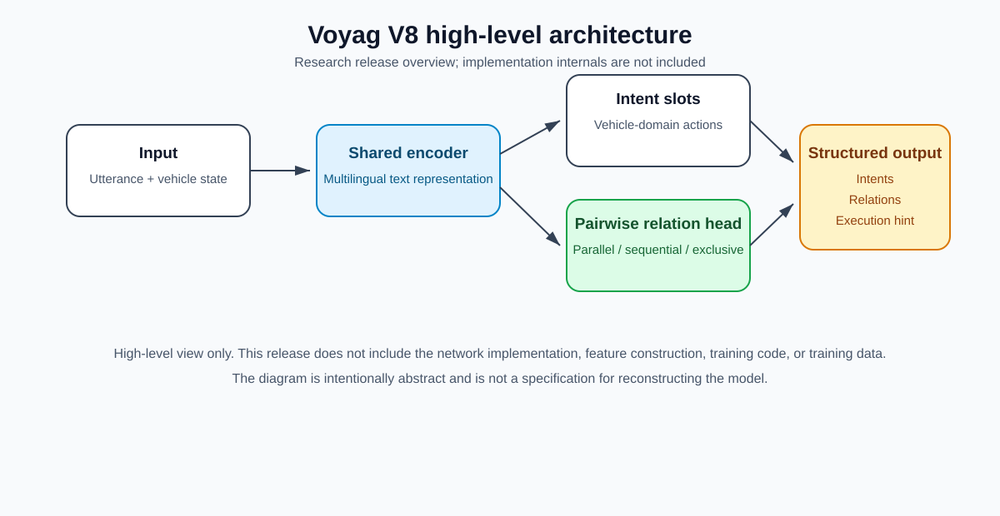

# Voyag V8

**ONNX local-inference release for in-vehicle multi-intent understanding.**


Voyag V8 reads a natural-language utterance together with vehicle state and
returns structured intent slots, pairwise execution relations, and an
execution hint for application logic. This repository is a self-contained
local inference package: users can run the model without a hosted service and
without PyTorch or the private training architecture.

## Quick start

```bash
pip install -r requirements.txt
python examples/inference_demo.py
```

### Get the weights

The ONNX graph `onnx/voyag-v8.onnx` is included in Git. The external weights
`onnx/voyag-v8.onnx.data` are distributed as a GitHub Release asset because
they exceed GitHub's normal repository file limit.

With the GitHub CLI:

```bash
gh release download v8.0.0 -p voyag-v8.onnx.data -D onnx
```

You can also download the asset from the repository Releases page and place it
in `onnx/`. Verify it with the SHA-256 value in `SHA256SUMS` before running.

Python API:

```python
from inference import VoyagOnnxPredictor

predictor = VoyagOnnxPredictor()
result = predictor.predict("打开车窗，同时把空调调到24度")
print(result)
print(predictor.device)   # effective execution device: "cuda" or "cpu"
```

The default ONNX graph is `onnx/voyag-v8.onnx`. Its weights are stored in the
accompanying external-data file `onnx/voyag-v8.onnx.data`; keep both files in
the same directory.

Non-Python languages (TypeScript / Node.js, C# / .NET, Java, Rust) are provided
in `bindings/`; see `bindings/README.md` for build and parity notes. All
bindings run the same ONNX graph and tokenizer on CPU.

## Runtime & device support

### CPU / GPU support

The inference runner executes through ONNX Runtime and auto-selects the
execution device:

1. Explicit `VoyagOnnxPredictor(providers=[...])` argument
2. `VOYAG_PROVIDER` environment variable (e.g. `CUDAExecutionProvider` /
   `CPUExecutionProvider`)
3. Automatic default: CUDA is used when the CUDAExecutionProvider loads
   successfully, otherwise the runner falls back to CPU

On Windows, `inference.py` registers the `nvidia/*/bin` dirs of pip-installed
NVIDIA CUDA wheels on the DLL search path in-process, so GPU users do not need
to edit PATH manually.

### Installation (GPU / NVIDIA)

`requirements.txt` defaults to a GPU environment: `onnxruntime-gpu==1.23.2`
plus four NVIDIA pip wheels (cuDNN, cuBLAS, CUDA Runtime, NVRTC). Driver >= 525
and 8GB+ VRAM recommended.

**Version pin rationale**: starting with onnxruntime 1.24, the Windows GPU
package no longer bundles CUDA/cuDNN DLLs, requiring a manual CUDA Toolkit
12.x + cuDNN 9.x installation and PATH setup. Pinning 1.23.2 with the NVIDIA
pip wheels works out of the box, with no NVIDIA-account downloads required.

### Installation (CPU-only)

Replace `onnxruntime-gpu` with `onnxruntime>=1.23.0` and drop the four
`nvidia-*` dependencies; no code changes needed.

### Performance reference (measured 2026-11-18 / 2026-11-19)

The ONNX release uses onnxruntime-gpu 1.23.2 on NVIDIA RTX 4080 Laptop 12 GB.

| Stage | GPU (CUDA EP) |
| --- | --- |
| Model load | 2.4 s |
| First inference (incl. warm-up) | 0.7 s |
| Steady-state single inference | ~0.18 s |

The same V8 model was re-verified on 2026-11-19 with the PyTorch release
package on the same host:

| Stage | GPU | CPU |
| --- | --- | --- |
| Steady-state single inference | 75-268 ms (median ~150 ms) | 1.6-2.1 s |
| GPU / CPU speedup | ~12x | |

Notes:

- The first inference includes CUDA kernel compilation and VRAM allocation;
  steady state starts afterwards.
- Reuse one `VoyagOnnxPredictor` instance; do not create one per request.

### Environment variables

| Variable | Meaning | Default |
| --- | --- | --- |
| `VOYAG_ONNX` | ONNX graph path | `./onnx/voyag-v8.onnx` |
| `VOYAG_PROVIDER` | Force an onnxruntime provider name (`CUDAExecutionProvider` / `CPUExecutionProvider`) | unset (auto) |
| `VOYAG_THREADS` | intra-op thread count for the CPU provider | `0` (auto) |

### Troubleshooting

This warning means the GPU is not in use and the runner fell back to CPU:

```text
warning: CUDAExecutionProvider requested but not active (active: ['CPUExecutionProvider']); running on CPU
```

- **onnxruntime >= 1.24**: downgrade to `onnxruntime-gpu==1.23.2` (see above).
- **Missing cuDNN / cuBLAS**: install `nvidia-cudnn-cu12`, `nvidia-cublas-cu12`,
  `nvidia-cuda-runtime-cu12`, and `nvidia-cuda-nvrtc-cu12`.
- **Outdated driver**: check `nvidia-smi` supports CUDA 12 (driver >= 525).

## Release scope

Included:

- Executable ONNX inference graph and its external weight data
- Tokenizer files
- Public slot and relation schema
- Python inference runner (`inference.py`) with minimal ONNX Runtime dependencies
- Runnable Python inference demo and example JSON
- Apache-2.0 license, model card, security policy, and checksums
- Abstract high-level architecture figure

Excluded:

- Training samples, datasets, and training code
- Evaluation and benchmark code
- Network architecture source code
- PyTorch checkpoint code or training architecture source
- Hosted inference service

The ONNX graph is the executable model artifact. It embeds the inference
topology and weights, but does not expose training code, data pipelines, loss
design, or alignment details.

## Input

The model accepts a JSON vehicle state. The only required field is
`utterance`; all other fields are optional and default to neutral values.

```json
{
  "utterance": "打开车窗，同时把空调调到24度",
  "speed_kmh": 0,
  "acc": "off",
  "window_state": "closed",
  "hvac_state": "on",
  "hvac_temperature_c": 22,
  "media_state": "idle",
  "seat_heat": "off",
  "light_state": "off",
  "phone_call": "idle",
  "nav_active": false,
  "battery_soc": 0.62,
  "gps_valid": true,
  "dtc": [],
  "warning": []
}
```

The exported graph has a fixed batch of 10 slots and a sequence length of
512. The public schema in `schema/voyag_schema.json` documents the slot order,
option labels, relation labels, and execution hints.

## Output

```json
{
  "utterance": "打开车窗，同时把空调调到24度",
  "model": "voyag-v8-onnx",
  "intents": [
    ["window", "open"],
    ["hvac", "set_temperature"]
  ],
  "relations": [
    {
      "source_id": "window",
      "target_id": "hvac",
      "type": "parallel",
      "confidence": 0.4311
    }
  ],
  "execution_hint": "parallel",
  "mutex_violations": [],
  "clarification": null
}
```

Confidence semantics:

- `intents` are selected by argmax. `none` slots are omitted.
- Intent probabilities are raw choice-head softmax with identity temperature
  `1.0`; no post-hoc intent temperature was fitted for V8.
- Relation probabilities have the fitted relation temperature
  `4.628923416137695` already applied inside the ONNX graph.
- Intent and relation confidence are not on the same scale and must not share
  a single threshold.

## High-level architecture



Voyag V8 maps an utterance and vehicle state into ten intent slots, pairwise
relations for active slots, and an execution hint. The figure is intentionally
abstract and omits feature construction, layer sizes, loss design, and
training alignment details.

## Evaluation summary

V8 was evaluated on a held-out synthetic test set of 5,000 groups, 50,000
slot questions, and 4,000 relation pairs.

| Head | Metric | Value |
|---|---:|---:|
| Intent | Accuracy | 0.9893 |
| Intent | Mean confidence | 0.9455 |
| Intent | ECE | 0.0526 |
| Relation | Accuracy | 0.85475 |
| Relation | Macro F1 | 0.8473 |

## Limitations

- Trained and evaluated on synthetic in-vehicle data, not a production fleet.
- Not a safety-rated vehicle controller.
- Known weakness on some held-out mutually exclusive cases.
- Media-domain slot accuracy is lower than other domains.
- Sequential cues are sometimes underused.
- Confidence is not a safety gate.

## Repository layout

```text
.
├─ assets/
│  └─ voyag-v8-architecture.svg
├─ examples/
│  ├─ inference_demo.py
│  ├─ state_message_call.json
│  └─ output_example.json
├─ onnx/
│  ├─ voyag-v8.onnx
│  └─ voyag-v8.onnx.data
├─ schema/
│  └─ voyag_schema.json
├─ tokenizer/
│  ├─ tokenizer.json
│  ├─ tokenizer_config.json
│  └─ special_tokens_map.json
├─ inference.py
├─ requirements.txt
├─ LICENSE
├─ MODEL_CARD.md
├─ README.md
├─ README_zh.md
├─ RELEASE_MANIFEST.md
├─ RELEASE_NOTES.md
├─ SECURITY.md
└─ SHA256SUMS
```

## Verification

SHA-256 checksums are recorded in `SHA256SUMS`.

Linux or macOS:

```bash
sha256sum -c SHA256SUMS
```

Windows PowerShell:

```powershell
Get-FileHash -Algorithm SHA256 .\onnx\voyag-v8.onnx
Get-FileHash -Algorithm SHA256 .\onnx\voyag-v8.onnx.data
```

The external weight data is approximately 1.3 GB and is published as a GitHub
Release asset. It is intentionally not tracked by Git.

## License

Released under the [Apache License 2.0](LICENSE).

## Security

See [SECURITY.md](SECURITY.md). Do not use public issues to report security
vulnerabilities.

## Contributing

This repository accepts fixes to the inference runtime, bindings, docs, and
release tooling. Training data, training code, and private architecture
contributions are out of scope. See [CONTRIBUTING.md](CONTRIBUTING.md).

CPU-only users can install from `requirements-cpu.txt` instead of the default
GPU-oriented `requirements.txt`.
