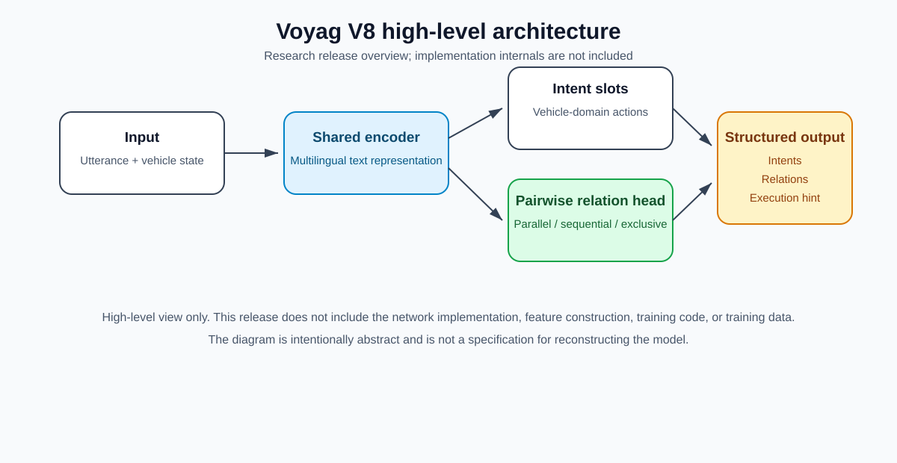

# Voyag V8

**面向车载多意图理解的 ONNX 本地推理发布包。**


Voyag V8 接收自然语言指令和车辆状态，输出结构化意图槽位、意图两两之间的执行关系，以及给应用层使用的执行建议。本仓库是自包含的本地推理包，用户不需要自建模型服务，也不依赖 PyTorch 或私有训练架构。

## 快速开始

```bash
pip install -r requirements.txt
python examples/inference_demo.py
```

### 获取权重

ONNX 图文件 `onnx/voyag-v8.onnx` 已包含在 Git 仓库中。外部权重
`onnx/voyag-v8.onnx.data` 因为超过 GitHub 普通仓库文件限制，以 GitHub Release
附件形式发布。

使用 GitHub CLI：

```bash
gh release download v8.0.0 -p voyag-v8.onnx.data -D onnx
```

也可以从仓库 Releases 页面手动下载并放入 `onnx/`。运行前请用
`SHA256SUMS` 中的 SHA-256 值校验该文件。

Python 调用：

```python
from inference import VoyagOnnxPredictor

predictor = VoyagOnnxPredictor()
result = predictor.predict("打开车窗，同时把空调调到24度")
print(result)
print(predictor.device)   # 实际生效的执行设备："cuda" 或 "cpu"
```

默认 ONNX 图文件是 `onnx/voyag-v8.onnx`，其权重存放在同目录的
`onnx/voyag-v8.onnx.data` 外部数据文件中。两个文件必须保持在同一目录。

## 运行时与设备支持

### CPU / GPU 支持

推理器通过 onnxruntime 执行，自动选择执行设备：

1. `VoyagOnnxPredictor(providers=[...])` 显式指定
2. 环境变量 `VOYAG_PROVIDER`（如 `CUDAExecutionProvider` / `CPUExecutionProvider`）
3. 默认自动：检测到 CUDAExecutionProvider 且加载成功就用 GPU，否则回退 CPU

`inference.py` 会在 Windows 上自动把 pip 安装的 NVIDIA CUDA wheels
（`nvidia/*/bin`）注册到 DLL 搜索路径，GPU 用户无需手动配置 PATH。

### 安装（GPU / NVIDIA）

`requirements.txt` 默认即为 GPU 环境：`onnxruntime-gpu==1.23.2` 加四个
NVIDIA pip wheels（cuDNN、cuBLAS、CUDA Runtime、NVRTC）。驱动要求 >= 525，
建议 8GB 以上显存。

**注意版本锁定**：onnxruntime 1.24 起 Windows GPU 包不再内置 CUDA/cuDNN
DLL，需要手动安装 CUDA Toolkit 12.x + cuDNN 9.x 并配置 PATH。锁定 1.23.2
配合 NVIDIA pip wheels 开箱即用，无需注册 NVIDIA 账号下载任何组件。

### 安装（CPU-only）

把 `onnxruntime-gpu` 换成 `onnxruntime>=1.23.0`、删掉四个 `nvidia-*`
依赖即可，代码无需改动。

### 性能参考（2026-11-18 / 2026-11-19 实测）

ONNX 发布包使用 onnxruntime-gpu 1.23.2，测试机为 NVIDIA RTX 4080 Laptop 12 GB。

| 阶段 | GPU（CUDA EP） |
| --- | --- |
| 模型加载 | 2.4 s |
| 首次推理（含预热） | 0.7 s |
| 稳态单次推理 | ~0.18 s |

同一 V8 模型于 2026-11-19 在 PyTorch 发布包上同机复测：

| 阶段 | GPU | CPU |
| --- | --- | --- |
| 稳态单次推理 | 75-268 ms（中位约 150 ms） | 1.6-2.1 s |
| GPU / CPU 加速比 | 约 12x | |

注意：

- 首次推理包含 CUDA kernel 编译与显存分配，之后才进入稳态。
- 复用同一个 `VoyagOnnxPredictor` 实例，不要每请求新建。

### 环境变量

| 变量 | 说明 | 默认 |
| --- | --- | --- |
| `VOYAG_ONNX` | ONNX 图路径 | `./onnx/voyag-v8.onnx` |
| `VOYAG_PROVIDER` | 强制 onnxruntime provider 名（`CUDAExecutionProvider` / `CPUExecutionProvider`） | 无（自动） |
| `VOYAG_THREADS` | CPU provider 的 intra-op 线程数 | `0`（自动） |

### 故障排查

出现以下告警表示 GPU 未生效、已回退 CPU：

```text
warning: CUDAExecutionProvider requested but not active (active: ['CPUExecutionProvider']); running on CPU
```

- **onnxruntime >= 1.24**：降级到 `onnxruntime-gpu==1.23.2`（见上）。
- **缺少 cuDNN / cuBLAS**：安装 `nvidia-cudnn-cu12`、`nvidia-cublas-cu12`、
  `nvidia-cuda-runtime-cu12`、`nvidia-cuda-nvrtc-cu12` 四个 pip 包。
- **驱动过旧**：`nvidia-smi` 确认驱动支持 CUDA 12（>= 525）。

## 发布范围

包含：

- 可执行的 ONNX 推理图及其外部权重数据
- Tokenizer 文件
- 公开槽位与关系 schema
- 仅依赖标准推理库的 Python 推理器 `inference.py`
- 可直接运行的 Python 推理 demo 和示例 JSON
- Apache-2.0 许可证、Model Card、安全说明和校验和
- 抽象的高层架构图

不包含：

- 训练样本、数据集和训练代码
- 评估和基准测试代码
- 网络架构源码
- PyTorch checkpoint 代码或训练架构源码
- 在线推理服务

ONNX 图本身就是可执行模型产物。它固化了推理拓扑和权重，但不会暴露训练代码、数据流程、损失设计或训练对齐细节。

## 输入

模型接收 JSON 格式的车辆状态。只有 `utterance` 是必填字段，其余字段可选并默认使用中性值。

```json
{
  "utterance": "打开车窗，同时把空调调到24度",
  "speed_kmh": 0,
  "acc": "off",
  "window_state": "closed",
  "hvac_state": "on",
  "hvac_temperature_c": 22,
  "media_state": "idle",
  "seat_heat": "off",
  "light_state": "off",
  "phone_call": "idle",
  "nav_active": false,
  "battery_soc": 0.62,
  "gps_valid": true,
  "dtc": [],
  "warning": []
}
```

导出图固定为 10 个槽位、512 的序列长度。`schema/voyag_schema.json`
定义了槽位顺序、选项标签、关系标签和执行建议。

## 输出

```json
{
  "utterance": "打开车窗，同时把空调调到24度",
  "model": "voyag-v8-onnx",
  "intents": [
    ["window", "open"],
    ["hvac", "set_temperature"]
  ],
  "relations": [
    {
      "source_id": "window",
      "target_id": "hvac",
      "type": "parallel",
      "confidence": 0.4311
    }
  ],
  "execution_hint": "parallel",
  "mutex_violations": [],
  "clarification": null
}
```

置信度语义：

- `intents` 由 argmax 得到，`none` 槽位不会出现在列表中。
- 意图概率是原始 choice-head softmax，温度为恒等值 `1.0`；V8 没有对意图头做后置温度拟合。
- 关系概率已在 ONNX 图内应用拟合后的关系温度 `4.628923416137695`。
- 意图置信度和关系置信度不在同一尺度，不能共用同一个阈值。

## 高层架构



Voyag V8 将用户指令和车辆状态映射为十个意图槽位、激活槽位两两关系以及执行建议。该图刻意保持抽象，不展示特征构造、层尺寸、损失设计或训练对齐细节。

## 评估摘要

V8 在 5,000 组、50,000 个槽位问题、4,000 个关系对的留出合成测试集上评估。

| 输出头 | 指标 | 数值 |
|---|---:|---:|
| 意图 | Accuracy | 0.9893 |
| 意图 | Mean confidence | 0.9455 |
| 意图 | ECE | 0.0526 |
| 关系 | Accuracy | 0.85475 |
| 关系 | Macro F1 | 0.8473 |

## 已知限制

- 仅在合成车载数据上训练和评估，不代表真实量产车队表现。
- 不是经过安全评级的车辆控制器。
- 在部分留出互斥场景上存在已知弱点。
- 媒体域槽位准确率低于其他域。
- 顺序线索有时未被充分利用。
- 置信度不能作为安全门控。

## 目录结构

```text
.
├─ assets/
│  └─ voyag-v8-architecture.svg
├─ examples/
│  ├─ inference_demo.py
│  ├─ state_message_call.json
│  └─ output_example.json
├─ onnx/
│  ├─ voyag-v8.onnx
│  └─ voyag-v8.onnx.data
├─ schema/
│  └─ voyag_schema.json
├─ tokenizer/
│  ├─ tokenizer.json
│  ├─ tokenizer_config.json
│  └─ special_tokens_map.json
├─ inference.py
├─ requirements.txt
├─ LICENSE
├─ MODEL_CARD.md
├─ README.md
├─ README_zh.md
├─ RELEASE_MANIFEST.md
├─ RELEASE_NOTES.md
├─ SECURITY.md
└─ SHA256SUMS
```

## 校验

所有发布文件的 SHA-256 校验和记录在 `SHA256SUMS`。

Linux 或 macOS：

```bash
sha256sum -c SHA256SUMS
```

Windows PowerShell：

```powershell
Get-FileHash -Algorithm SHA256 .\onnx\voyag-v8.onnx
Get-FileHash -Algorithm SHA256 .\onnx\voyag-v8.onnx.data
```

外部权重数据约 1.3 GB，作为 GitHub Release 附件发布，Git 仓库不跟踪该文件。

## 许可证

依据 [Apache License 2.0](LICENSE) 发布。

## 安全

见 [SECURITY.md](SECURITY.md)。请勿通过公开 issue 报告安全漏洞。

## 参与贡献

本仓库接受推理运行时、语言绑定、文档和发布工具的修复。训练数据、训练代码和
私有架构贡献不在范围内。详见 [CONTRIBUTING.md](CONTRIBUTING.md)。

仅使用 CPU 的用户可以安装 `requirements-cpu.txt`，无需安装默认的 GPU 依赖。
